# Algoradix hardware

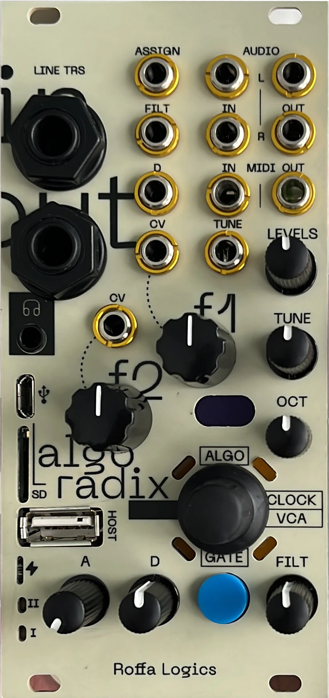

**Algoradix** is a 12 HP Eurorack synth voice by **Roffa Logics**. It turns an
[Axoloti Core v1.2](https://github.com/axoloti/axoloti) into a playable module, with eight pots, six CV inputs, stereo
audio in and out, TRS MIDI in and out, a gate/function button, an encoder with four ring LEDs, and a small OLED. The
Core's own line jacks, headphone output, micro-SD, mini-USB and USB host port come through the panel.

This repository holds the open hardware: the **interface board**, the **connector board** that joins it to the
Core, the **front panel** (two colour variants), the BOM, the extracted netlist, assembly notes and photos. The
firmware is in the companion repository **[algoradix-firmware](https://github.com/Gianducaconte/algoradix-firmware)**.

 

| | |
|---|---|
| Format | Eurorack, 3U, 12 HP (panel 60.2 × 128.75 mm) |
| Brain | Axoloti Core v1.2: STM32F427 at 168 MHz, ADAU1961 24-bit codec at 48 kHz, 8 MB SDRAM, micro-SD |
| Controls | 8 pots (f1, f2, TUNE, OCT, A, D, FILT, LEVELS), EC11 encoder with push, GATE/FUNC button |
| CV inputs | f1, f2, TUNE (1 V/oct), D, FILT, ASSIGN. Summed with the pot in analog, 400 ADC counts per volt |
| Audio | stereo IN (attenuated to line level, right normalled to left), stereo OUT (amplified to Eurorack level) |
| MIDI | TRS IN and OUT on the panel, plus USB host (USB-A) on the Core |
| Display | SSD1306 OLED, 64 × 32, I2C |
| Power | Eurorack 10-pin, ±12 V |

## Contents

| Path | What |
|---|---|
| [`docs/architecture.md`](docs/architecture.md) | how the three boards and the Core fit together, power and signal flow |
| [`docs/interface-board.md`](docs/interface-board.md) | the interface board circuits: CV summing amplifiers, −10 V reference, audio in and out, controls |
| [`docs/pinout.md`](docs/pinout.md) | the 30-pin FPC between the boards, and every panel control mapped to its STM32 pin |
| [`docs/build-guide.md`](docs/build-guide.md) | ordering the boards and the panel, parts outside the BOM, assembly order, first power-up |
| [`pcb/interface-board/gerbers/`](pcb/interface-board/gerbers/) | Gerbers and drills, interface board (52.7 × 110.2 mm, 2 layers, SMD on the back) |
| [`pcb/connector-board/gerbers/`](pcb/connector-board/gerbers/) | Gerbers and drills, connector board (109.8 × 23.1 mm, 2 layers) |
| [`panel/variant-A/`](panel/variant-A/), [`panel/variant-B/`](panel/variant-B/) | front panel Gerbers, two artwork variants |
| [`bom/interface-board-bom.csv`](bom/interface-board-bom.csv) | interface board bill of materials (106 parts) |
| [`schematic/interface-board-netlist.txt`](schematic/interface-board-netlist.txt) | full netlist of the interface board |
| [`images/`](images/) | photos of the build, and renders of the boards and panels made from the Gerbers |

## The boards

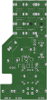
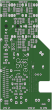
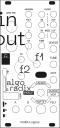
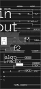

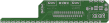

**Interface board.** All the panel jacks, pots, the encoder, the button and the ring LEDs. Three MCP6002 op-amps on
3.3 V sum each pot with its CV jack and scale the result to the 0–3.3 V range of the ADC. The rail-to-rail output also
protects the STM32 from out-of-range CV. Two TL072s on ±12 V buffer the audio: they bring Eurorack levels down to
line level for the codec, and line level back up for the outputs. One 30-pin FPC cable carries everything to the
connector board.

**Connector board.** Plugs onto the Core's GPIO header. It takes the FPC from the interface board, the Eurorack power
header (with reverse-polarity diodes), and breaks out power for the Core and the interface board, MIDI to the Core,
and an I2C header for the OLED.

**Panel.** Made as a PCB, with the artwork in the solder-mask layer. Variant A and variant B are the two colourways
(the photos show both).

## Photos

| | | |
|---|---|---|
| 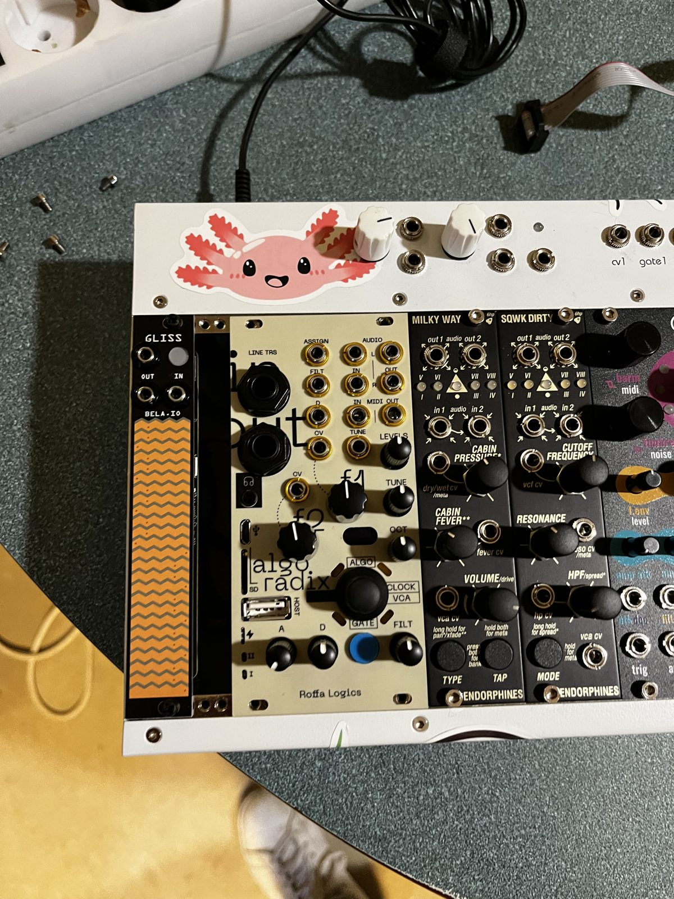 | 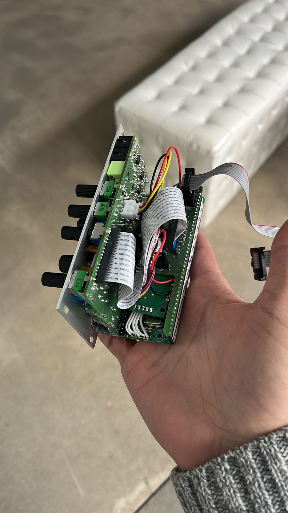 | 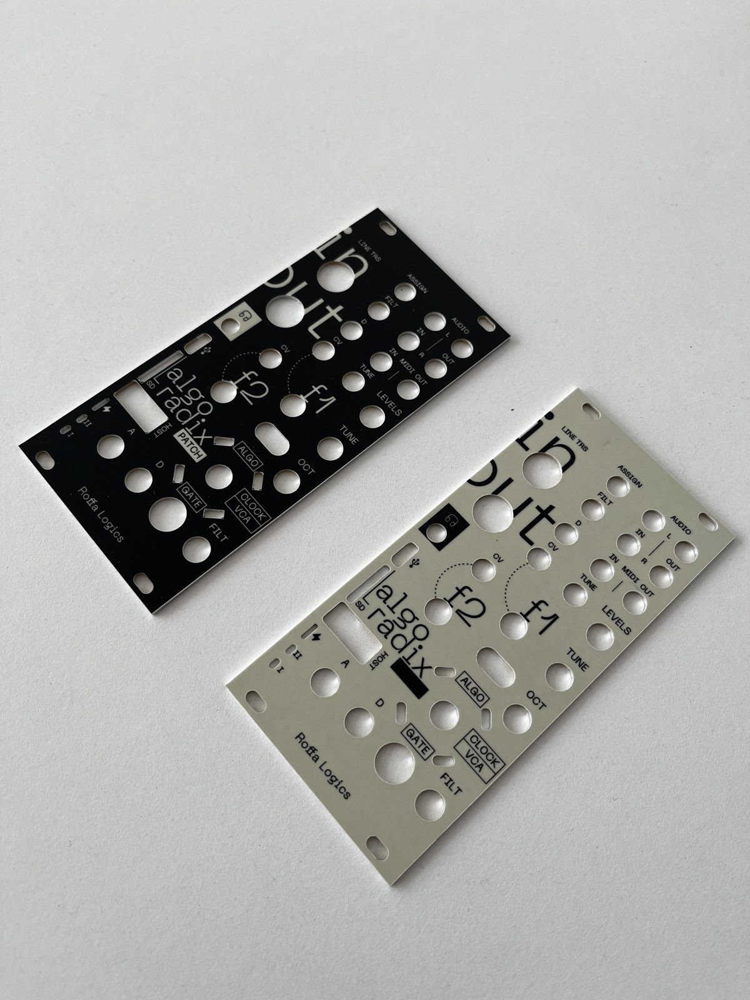 |
| in the rack | the stack from the side | the two panel variants |
| 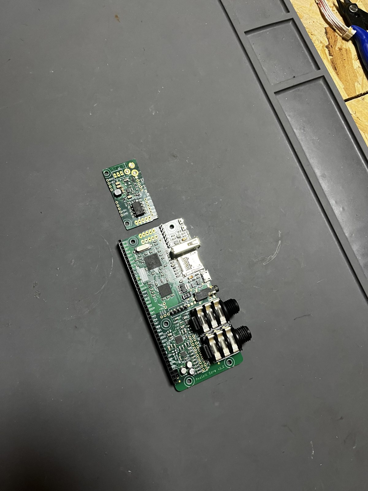 | 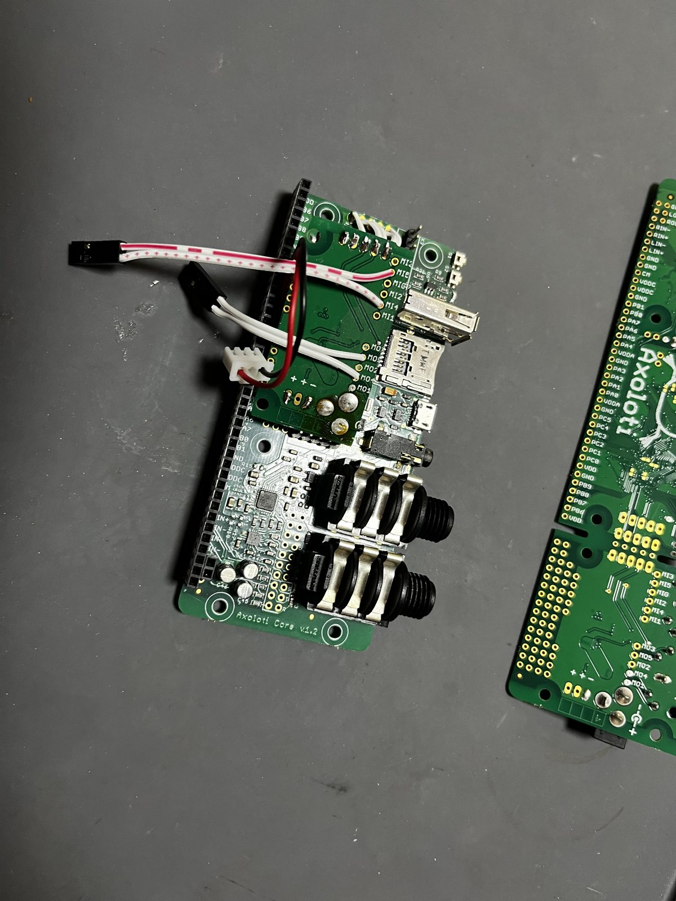 | 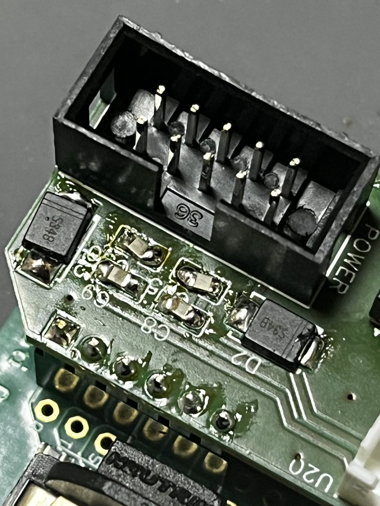 |
| Axoloti Core and connector board | connector board fitted | Eurorack power header |
| 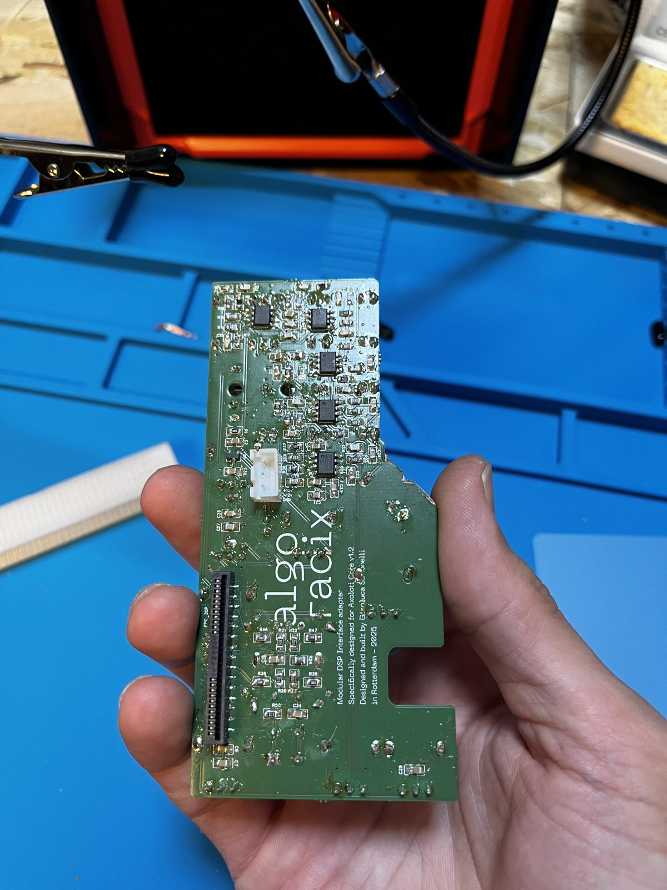 | 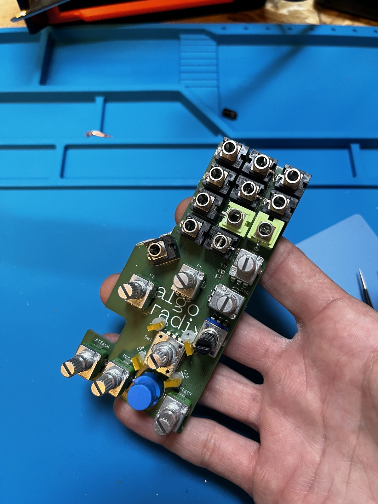 | 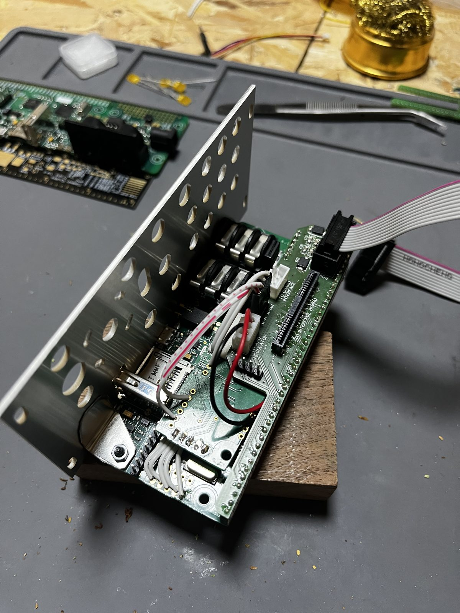 |
| interface board, SMD side | interface board populated | behind the panel |

More in [`images/photos/`](images/photos/).

## Licence

Copyright © 2025–2026 Roffa Logics. Designed by Gianluca Simonelli.

This hardware is licensed under the **CERN Open Hardware Licence Version 2 – Strongly Reciprocal**
(CERN-OHL-S-2.0). See [LICENSE](LICENSE). You may redistribute and modify this documentation and make products
using it under the terms of the CERN-OHL-S v2 (https://ohwr.org/cern_ohl_s_v2.txt). This documentation is
distributed WITHOUT ANY EXPRESS OR IMPLIED WARRANTY, INCLUDING OF MERCHANTABILITY, SATISFACTORY QUALITY AND FITNESS
FOR A PARTICULAR PURPOSE. Please see the CERN-OHL-S v2 for applicable conditions.

The **Axoloti Core v1.2** is a separate open-hardware design by Johannes Taelman, published by the Axoloti project.
It isn't part of this repository and isn't covered by this licence. Algoradix is independent of the Axoloti project,
which hasn't endorsed it.
