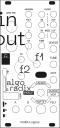
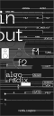

# Front panel

12 HP Eurorack panel, 60.2 × 128.75 mm, made as a PCB.

| File | Layer |
|---|---|
| `algoradix-panel.GKO` | outline and every hole (jacks, pots, encoder, button, LED window, display window, the Core's connectors, rail slots) |
| `algoradix-panel.GTS` | top solder mask: **the artwork** |
| `algoradix-panel.GTL` | top copper: plated rings around the jacks |
| `algoradix-panel.DRL` | drill file (empty: all holes are milled from the outline) |

`variant-A` and `variant-B` share the outline and copper and differ only in the solder-mask artwork. They're the two
colourways in [the photos](../images/photos/04-panels-black-white.jpg).

